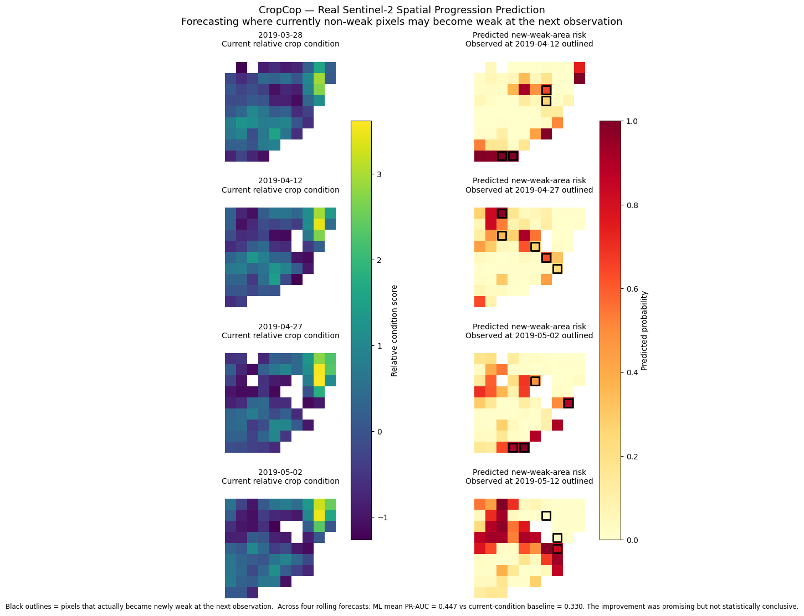
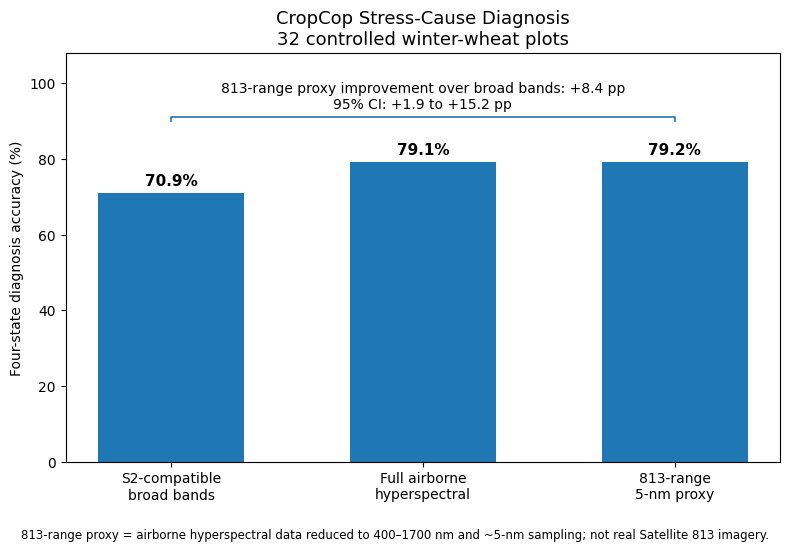

# CropCop

**Challenge 813 — Precision Agriculture & Crop Intelligence**  
**Team:** CropCops  
**Country:** United Arab Emirates

## One-line summary

CropCop is a satellite-based crop early-warning proof of concept that uses real Sentinel-2 time series to identify where crop-condition weakness may emerge next, while hyperspectral information supports diagnosis of nitrogen-, water-, and mixed-treatment crop stress.

---

## Business use case

CropCop is designed for farmers, agronomists, crop managers, and agricultural decision-makers, particularly in arid and semi-arid regions where water and nutrient resources must be managed carefully.

The system is intended to support two practical decisions:

1. **Where should the field be inspected or treated next?**
2. **What is the likely cause of the observed crop stress?**

Instead of relying only on visible symptoms or field scouting after damage has already developed, CropCop combines repeated satellite monitoring with richer spectral diagnostic information to support earlier intervention.

---

## Problem

Crop stress caused by water limitation, nitrogen deficiency, disease, salinity, and other factors can produce similar visible symptoms.

This creates two challenges:

- detecting crop deterioration early enough to intervene;
- distinguishing the likely cause of the stress.

Satellite remote sensing is well suited to the first challenge because it provides repeated spatial observations across an entire field.

Hyperspectral information provides a richer spectral description of vegetation than broad multispectral bands and may improve stress-cause diagnosis.

CropCop demonstrates these two capabilities through the workflow:

**Detect → Diagnose → Predict spatial progression → Support earlier intervention**

---

# Data used

## 1. Real Sentinel-2 Level-2A imagery

**Product:** Sentinel-2 Level-2A surface reflectance  
**Provider:** Copernicus / European Space Agency  
**Purpose:** Real-satellite crop-condition monitoring and spatial-progression prediction

Three example Sentinel-2 acquisitions are committed in `data/sample_input/`:

- 10 March 2019
- 12 April 2019
- 14 May 2019

The notebook also queries a larger Sentinel-2 Level-2A time series through the Microsoft Planetary Computer STAC API.

The final time-series analysis uses **14 observations from a single relative orbit** between February and May 2019.

Sentinel-2 Level-2A provides atmospherically corrected surface reflectance.

Copernicus Sentinel data are available on a free, full and open basis under the Copernicus Sentinel data terms.

Source:  
https://dataspace.copernicus.eu/data-collections/copernicus-sentinel-missions/sentinel-2

Terms:  
https://dataspace.copernicus.eu/terms-and-conditions

---

## 2. Controlled winter-wheat experiment

**Dataset:** Agronomic, weather, and remote sensing data for the simultaneous assessment of nitrogen and water status in winter wheat using hyperspectral and thermal sensors

**Provider:** CSIC / Mendeley Data  
**DOI:** https://doi.org/10.17632/b7xg8d8m9k.2  
**Licence:** CC BY 4.0

Files used:

- `Crop_agronomic_data_wheat.xlsx`
- `Crop_Reflectance_temp_from_Plane_Corrected.xlsx`

The experiment was conducted at La Chimenea research farm near Aranjuez, Spain.

The diagnosis experiment uses **32 winter-wheat plots** representing combinations of:

- four nitrogen treatments;
- two water regimes;
- four repetitions.

The airborne dataset contains plot-level hyperspectral reflectance and canopy-temperature measurements.

The agronomic dataset provides treatment information and measured crop variables, including Nitrogen Nutrition Index (NNI).

For the final diagnosis experiment, measurements from **16 May 2019** are used.

Dataset:  
https://data.mendeley.com/datasets/b7xg8d8m9k/2

---

## 3. Sentinel-2 spectral-response functions

Official Sentinel-2 spectral-response functions are downloaded automatically by the notebook and used to convert the airborne hyperspectral spectra into a controlled Sentinel-2-compatible broad-band representation.

These features are used only for a controlled spectral comparison.

They are **not real Sentinel-2 satellite observations**.

---

# Technical approach

## A. Real-satellite monitoring

The notebook:

1. extracts the supplied Sentinel-2 Level-2A example scenes;
2. defines the experimental-field area of interest;
3. queries the Microsoft Planetary Computer for Sentinel-2 Level-2A observations;
4. restricts the main time series to a consistent relative orbit;
5. calculates:
   - NDVI
   - NDRE
   - NDMI
6. combines the indices into a same-date relative crop-condition score;
7. identifies relatively weak field areas.

The relative score compares pixels within the field at each date rather than representing an absolute physiological stress measurement.

---

## B. Spatial-progression prediction

The strict CropCop progression experiment asks:

> **Among pixels that are not currently weak, which pixels are most likely to become weak at the next Sentinel-2 observation?**

Predictive features include:

- current relative crop condition;
- recent condition trend;
- neighbouring weak-area fraction;
- forecast horizon.

A logistic-regression model is evaluated using rolling forecast origins.

Performance is compared with:

- current condition alone;
- neighbour-only prediction;
- trend-only prediction.

Spatial-block bootstrap resampling is used to estimate uncertainty while reducing the effect of treating neighbouring pixels as independent observations.

---

## C. Stress-cause diagnosis

The controlled diagnosis task contains four treatment-condition classes:

- Reference
- Nitrogen deficiency
- Water stress
- Mixed stress

Separate nitrogen and water Partial Least Squares (PLS) models are trained using a frozen repeated nested cross-validation protocol.

The following sensor representations are compared:

- airborne-derived Sentinel-2-compatible broad bands;
- full airborne hyperspectral reflectance;
- airborne canopy temperature;
- Sentinel-2-compatible bands + temperature;
- hyperspectral reflectance + temperature.

---

## D. Satellite 813 spectral relevance

An additional hyperspectral representation reduces the airborne spectra to:

- **400–1700 nm**
- approximately **5-nm sampling**

This is used as an **813-range spectral proxy** to test whether the diagnostic result depends on the extremely dense sampling of the original airborne sensor.

This is **not real Satellite 813 imagery**.

The proxy does not reproduce:

- atmospheric effects;
- real satellite signal-to-noise;
- 20-m spatial mixing;
- exact Satellite 813 spectral response functions;
- real Satellite 813 acquisition conditions.

---

# Installation

The repository was tested successfully in Google Colab using:

**Python 3.13.16**

Clone the repository:

```bash
git clone https://github.com/FYA1100/CropCop.git
cd CropCop
```

Install the pinned dependencies:

```bash
python -m pip install -r requirements.txt
```

---

# How to run

Main notebook:

```text
notebooks/CropCop_Final_PoC3.ipynb
```

Open the notebook in Jupyter or Google Colab and run all cells from top to bottom.

The notebook expects the repository structure to remain unchanged so that it can find:

```text
data/sample_input/
```

Network access is required for:

- Microsoft Planetary Computer Sentinel-2 access;
- downloading the official Sentinel-2 spectral-response workbook.

A command-line reproducibility test can be run with:

```bash
jupyter nbconvert \
  --to notebook \
  --execute notebooks/CropCop_Final_PoC3.ipynb \
  --output CropCop_test.ipynb \
  --ExecutePreprocessor.timeout=-1
```

The repository version was successfully tested from a **fresh Google Colab clone** using this procedure.

Runtime depends on network and compute performance because the notebook performs live satellite access, repeated cross-validation, and bootstrap evaluation.
Expected runtime: Approximately 45–60 minutes in Google Colab for a full end-to-end execution. Runtime may vary depending on network access and available compute.

---

# Example input

Example Sentinel-2 and controlled-experiment input files are provided under:

```text
data/sample_input/
```

The directory contains:

```text
Crop_agronomic_data_wheat.xlsx
Crop_Reflectance_temp_from_Plane_Corrected.xlsx

S2_2019-03-10_10m.zip.zip
S2_2019-03-10_20m.zip.zip
S2_2019-04-12_10m.zip.zip
S2_2019-04-12_20m.zip.zip
S2_2019-05-14_10m.zip.zip
S2_2019-05-14_20m.zip.zip
```

---

# Example outputs

## Real Sentinel-2 spatial-progression prediction

Black outlines indicate pixels that actually became newly weak at the following satellite observation.



Across four rolling forecast origins:

- **ML mean PR-AUC: 0.447**
- Current-condition baseline: **0.330**
- Neighbour-only baseline: **0.197**
- Trend-only baseline: **0.104**

The observed ML improvement over current condition was promising but not statistically conclusive.

---

## Hyperspectral stress-cause diagnosis



Four-state diagnosis accuracy:

| Spectral representation | Accuracy |
|---|---:|
| Sentinel-2-compatible broad bands | 70.9% |
| Full airborne hyperspectral | 79.1% |
| 813-range 5-nm proxy | 79.2% |

The 813-range proxy improved treatment-defined four-state diagnosis by approximately **8.4 percentage points** relative to the broad Sentinel-2-compatible representation.

Paired plot-cluster bootstrap:

**95% CI: +1.9 to +15.2 percentage points**

The 813-range proxy and full airborne hyperspectral representations performed essentially identically.

---

# Validation

## Spatial progression

Only pixels that were not currently weak were included in the strict emergence evaluation.

Across the four evaluation dates, **16 newly weak pixel-events** occurred.

The ML model had the highest observed mean PR-AUC, but the spatial-block bootstrap interval for improvement over current condition crossed zero.

Therefore, the result demonstrates a functioning **next-observation spatial-risk pipeline**, not proven superiority over current crop condition.

---

## Diagnosis

The main diagnosis experiment uses frozen repeated nested cross-validation.

The hyperspectral advantage is also tested using an alternative physiological definition of nitrogen status based on:

**NNI ≤ 0.80**

Under this sensitivity analysis:

- S2-compatible representation: **78.1%**
- Full hyperspectral representation: **76.6%**

No clear hyperspectral advantage was observed under this alternative definition.

This indicates that the benefit of hyperspectral information depends on the specific stress definition and should not be interpreted as universally superior.

---

# Important limitations

- Real Sentinel-2 imagery provides the real-satellite component of this PoC.
- Hyperspectral and thermal measurements were acquired from an aircraft.
- Sentinel-2-compatible diagnosis bands are mathematically derived from airborne hyperspectral measurements and are not real satellite observations.
- The 813-range 5-nm representation is a spectral proxy, not real Satellite 813 data.
- Exact geographic polygons for the 32 controlled experimental plots were unavailable.
- Therefore, controlled diagnosis labels cannot currently be mapped reliably onto individual real Sentinel-2 pixels.
- Satellite progression and controlled stress-cause diagnosis are validated at different spatial scales.
- The progression target represents relative satellite-observed crop condition, not independently measured biological stress spread.
- Only 16 new weak-area events were available for the strict progression test.
- Results are based on one experimental location and season and require external multi-field and multi-season validation before operational deployment.

---

# Repository structure

```text
CropCop/
├── README.md
├── requirements.txt
│
├── notebooks/
│   └── CropCop_Final_PoC3.ipynb
│
├── data/
│   └── sample_input/
│
└── results/
    ├── cropcop_diagnosis.png
    └── cropcop_spatial_progression.png
```

---

# Team

**Team CropCops — United Arab Emirates**

- **Abdulrahman Abdulrahman** — Problem Definition & Results Visualization Lead
- **Faisal Aljuryyed** — Hyperspectral & Remote Sensing Lead; Presentation Lead
- **Fatma Alsuwaidi** — Earth Observation & Satellite Data Lead; Technical Validation Lead
- **Mariam Albloushi** — Agricultural Research & Documentation Lead
- **Said Alagha** — Data Processing & Machine Learning Lead

---

# Attribution

Controlled wheat experiment:

Quemada, M. et al.  
*Agronomic, weather, and remote sensing data for the simultaneous assessment of nitrogen and water status in winter wheat using hyperspectral and thermal sensors.*  
Mendeley Data, Version 2.  
DOI: https://doi.org/10.17632/b7xg8d8m9k.2  
Licence: CC BY 4.0.

Satellite imagery:

Contains modified Copernicus Sentinel-2 data.

Microsoft Planetary Computer is used to access additional Sentinel-2 Level-2A observations programmatically.

---

# Licence

Third-party datasets remain subject to their respective licences and terms listed above.
